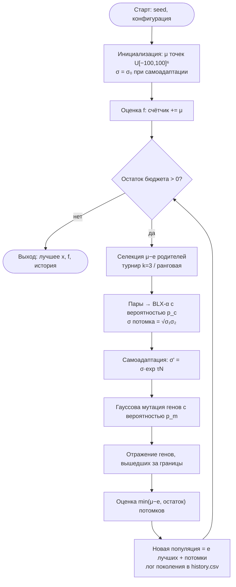
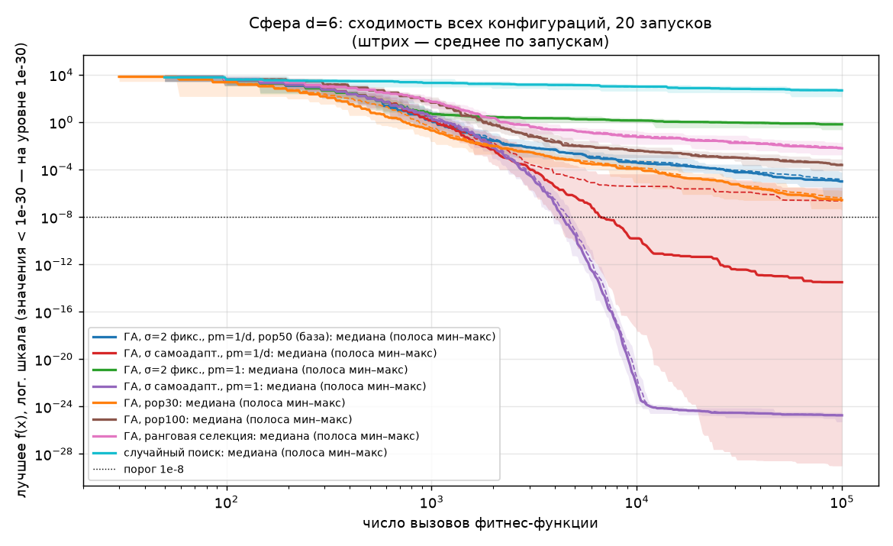
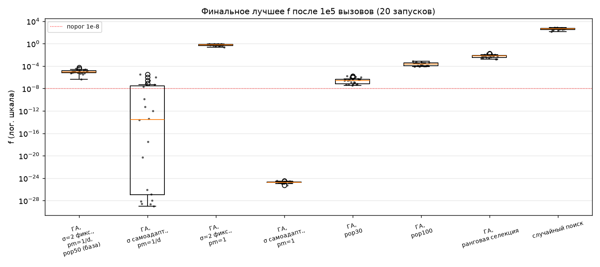

# Отчёт по лабораторной работе № 1
## Многомерная оптимизация функции сферы генетическим алгоритмом

Воспроизведение: `make all`.

## 1. Постановка задачи и индивидуальный вариант

Параметры студента: N = 20, Q = 2 (группа 527), Y = 26.

V = 1 + ((17·20 + 7·2 + 26) mod 20) = 1 + (380 mod 20) = 1,
d = 5 + (V mod 6) = 6.

Вариант 1: функция сферы

  f(x) = Σᵢ₌₁⁶ xᵢ²,  −100 ≤ xᵢ ≤ 100.

Требуется найти min f(x) на D = [−100, 100]⁶. Теоретический минимум: f\* = 0 при x\* = 0.

Критерий «хорошего результата» зафиксирован до запусков: f < 10⁻⁸ во всех 20
запусках при бюджете 10⁵ вызовов функции.

## 2. Пространство решений, целевая функция, ограничения

- Пространство решений: D = [−100, 100]⁶ ⊂ ℝ⁶ (гиперкуб, объём 200⁶ = 6.4·10¹³).
- Цель: минимизировать f(x) = ‖x‖².
- Ограничения: только «коробочные» lᵢ ≤ xᵢ ≤ uᵢ. Других ограничений нет.
- Свойства f: гладкая, выпуклая, унимодальная, сепарабельная, изотропная
  (зависит только от ‖x‖). Линии уровня — сферы.

## 3. Представление особи

- Генотип. Вещественный вектор (x₁, …, x₆). В конфигурациях с самоадаптацией
  к нему добавлен личный шаг мутации σ > 0: (x₁, …, x₆, σ).
- Фенотип. Точка x ∈ D.
- Декодирование. Тождественное: x берётся из первых d генов. σ на значение f не влияет,
  она управляет только мутацией.
- Допустимость: после каждой вариации гены, вышедшие за [−100, 100], отражаются
  обратно (раздел 6). Поэтому каждая вычисляемая особь лежит в D.

## 4. Алгоритм, операторы и параметры

Генерационный ГА с элитизмом (`eaga/core.py: run_ga`):

1. Инициализация: μ точек равномерно в D (σ = σ₀ для самоадаптивных).
2. Оценка f для всех. Каждая строка — один вызов, счётчик встроен в обёртку
   `CountedFunction`.
3. Пока бюджет не исчерпан:
   - селекция μ − e родителей (турнир k = 3 или линейная ранговая);
   - разбиение на пары, BLX-α с вероятностью p_c (иначе копии родителей);
   - гауссова мутация (каждый ген с вероятностью p_m);
   - отражение от границ;
   - оценка потомков;
   - новая популяция = e лучших старых (элита) + потомки.
   Если бюджета меньше, чем потомков, оценивается только остаток, и бюджет
   расходуется ровно до 10⁵.
4. Результат: лучшая точка за всё время (её же хранит элита).

Таблица параметров (полные значения в `lab1/configs/*.json`):

| параметр | база `base_fixed` | изменения в других конфигурациях |
|---|---|---|
| размер популяции μ | 50 | `pop30`: 30; `pop100`: 100 |
| элита e | 2 | — |
| потомков за поколение | μ − e = 48 | 28 / 98 |
| поколений при бюджете 10⁵ | 2083 | 3571 (`pop30`), 1020 (`pop100`) |
| селекция | турнир, k = 3, с возвращением | `ranking`: линейная ранговая, s = 1.5, SUS |
| кроссовер | BLX-α, α = 0.5, p_c = 0.9 | — |
| мутация | гауссова, σ = 2 (1% ширины области), фиксированная | `selfadaptive_*`: личная σ, логнормальная самоадаптация |
| p_m (на ген) | 1/d = 1/6 | `fixed_pm1`, `selfadaptive_pm1`: 1 |
| самоадаптация σ | — | σ₀ = 2, τ = 1/√d ≈ 0.408, σ ∈ [10⁻¹², 200], σ потомков при кроссовере = √(σ₁σ₂) |
| выход за границы | отражение | — |
| инициализация | U[−100, 100]⁶ | — |
| остановка | 10⁵ вызовов f | — |
| seed | 0…19 (`make_rng(seed)`, PCG64) | одинаковые для всех конфигураций |
| случайный поиск | — | 10⁵ точек U[−100, 100]⁶ |

Дополнительное задание. Сделан адаптивный масштаб гауссовской мутации:
логнормальная самоадаптация σ' = σ·exp(τ·N(0,1)), затем x' = x + σ'·N(0, I) на
мутируемых генах. Код: `lab1/operators.py: lognormal_sigma`, `lab1/ga.py`.
Попутно реализована ранговая селекция (`eaga/selection.py: linear_ranking`).

## 5. Блок-схема

## 6. Обоснование операторов относительно структуры задачи

- Вещественное кодирование требуется заданием. Для сферы оно естественно:
  фенотип совпадает с генотипом, и нет погрешности квантования, как у
  двоичного кода. Это важно при цели 10⁻⁸.
- BLX-0.5. Потомок выбирается в расширенном на 50% параллелепипеде родителей.
  Разброс потомков пропорционален расстоянию между родителями, поэтому при
  сжатии популяции к оптимуму шаг кроссовера сам уменьшается. Сфера
  сепарабельна, а BLX работает покоординатно, так что структура функции
  оператору не мешает. При α = 0.5 BLX приблизительно сохраняет дисперсию
  популяции, поэтому само по себе сжатие делает отбор, а не кроссовер.
- Гауссова мутация даёт непрерывные малые сдвиги любого масштаба и изотропна,
  как и сама функция. Её недостаток с фиксированной σ — фиксированный
  масштаб (см. разделы 8–9).
- Самоадаптация σ. Для сферы оптимальный шаг пропорционален расстоянию до
  оптимума: σ\* ∝ ‖x‖/d. По мере приближения нужная σ уменьшается на много
  порядков, а самоадаптация отслеживает её без внешнего расписания.
- Турнир k = 3. Не зависит от масштаба f. Это важно, потому что значения f
  меняются от 10⁴ до 10⁻²⁵, и рулетка без масштабирования здесь неприменима.
  Давление умеренное: лучший получает в среднем ≈ 3 копии.
  Ранговая селекция с s = 1.5 даёт более слабое давление: 1.5 копии.
- Отражение вместо клиппинга. Клиппинг отображает целую полупрямую выходов
  в одну граничную точку, и на гранях куба, где f максимальна, скапливается
  вероятностная масса. Отражение непрерывно и сохраняет
  распределение шага у границы. Оптимум внутренний, поэтому выходы за границы
  случаются только в начале поиска.
  *Замечание о реализации:* первая версия применяла формулу отражения
  lo + mod(x − lo, 2r) ко всем генам. Это округляло x до шага ulp(100) ≈ 1.4·10⁻¹⁴
  и давало ложные точные нули f = 0. Ошибка найдена при анализе результатов и
  исправлена: отражаются только гены вне области. Регрессионный тест:
  `tests/test_lab1.py::test_reflect_inside_unchanged_bitwise`. Все результаты
  ниже получены после исправления.
- Элитизм (e = 2) гарантирует, что лучшее найденное решение не теряется:
  лучший в популяции монотонно не ухудшается. Это проверено тестом.

## 7. Результаты 20 независимых запусков

Для каждой конфигурации выполнено 20 запусков (seed 0…19), бюджет ровно 10⁵ вызовов.
Данные по каждому запуску лежат в `results/<конфигурация>/runs.csv` (seed, best_f, evals,
time_s, generations, hit_eval/hit_gen — вызов и поколение первого достижения f < 10⁻⁸,
best_x). История по поколениям — в `results/<конфигурация>/history.csv` (лучшее за всё
время, лучшее/среднее/медиана популяции, разнообразие, медиана σ).

Сводка (`results/summary.md`; best = min, worst = max, std выборочное):

<!-- BEGIN include: results/summary.md -->
| конфигурация | запусков | best | mean | median | std | worst | доля f<1e-8 | вызовов | время, с | медиана вызова достижения 1e-8 (по успешным) |
|---|---|---|---|---|---|---|---|---|---|---|
| base_fixed | 20 | 4.662e-07 | 1.401e-05 | 9.809e-06 | 1.388e-05 | 5.998e-05 | 0.00 | 100000 | 0.152 | — |
| selfadaptive_sigma | 20 | 9.689e-30 | 2.253e-07 | 3.088e-14 | 7.133e-07 | 3.097e-06 | 0.70 | 100000 | 0.216 | 5992 |
| fixed_pm1 | 20 | 2.272e-01 | 6.247e-01 | 6.480e-01 | 2.039e-01 | 9.375e-01 | 0.00 | 100000 | 0.151 | — |
| selfadaptive_pm1 | 20 | 5.062e-26 | 1.882e-25 | 1.799e-25 | 6.613e-26 | 3.143e-25 | 1.00 | 100000 | 0.212 | 4292 |
| pop30 | 20 | 3.708e-08 | 4.081e-07 | 2.634e-07 | 4.617e-07 | 1.693e-06 | 0.00 | 100000 | 0.245 | — |
| pop100 | 20 | 7.853e-05 | 2.709e-04 | 2.414e-04 | 1.873e-04 | 7.714e-04 | 0.00 | 100000 | 0.088 | — |
| ranking | 20 | 1.699e-03 | 6.832e-03 | 6.185e-03 | 4.545e-03 | 1.868e-02 | 0.00 | 100000 | 0.172 | — |
| random_search | 20 | 1.366e+02 | 4.606e+02 | 4.701e+02 | 1.634e+02 | 7.358e+02 | 0.00 | 100000 | 0.014 | — |
<!-- END include -->

Графики (все строятся из CSV, `--plots-only` пересобирает их без запусков):

| файл | содержание |
|---|---|
| `results/convergence_all.png` | лучшее f по вызовам: медиана, среднее (штрих), полоса мин–макс по 20 запускам; все конфигурации и случайный поиск, лог. шкала |
| `results/convergence_sigma.png` | фиксированная σ против самоадаптивной (две пары) |
| `results/convergence_pop.png` | μ = 30 / 50 / 100 |
| `results/boxplot_final.png` | финальные значения f, все точки поверх коробок |
| `results/sigma_adaptation.png` | медиана σ в популяции по вызовам и масштаб √(f/d) |
| `results/random_search_theory.png` | случайный поиск против теоретической кривой ∝ B^(−1/3) |

## 8. Анализ результатов

### 8.1. Критерий f < 10⁻⁸ во всех запусках

| конфигурация | доля запусков с f < 10⁻⁸ |
|---|---|
| `selfadaptive_pm1` | 20/20 — критерий выполнен |
| `selfadaptive_sigma` | 14/20 |
| все остальные ГА и случайный поиск | 0/20 |

### 8.2. Эксперимент 1 — базовая конфигурация (σ = 2 фикс., p_m = 1/d, μ = 50)

Медиана 9.8·10⁻⁶, разброс от 4.7·10⁻⁷ до 6.0·10⁻⁵. Порог 10⁻⁸ не достигнут ни разу.
Сходимость замедляется. Медиана лучшего f по запускам: 1.6 после 10³ вызовов,
3.8·10⁻⁴ после 10⁴, 2.3·10⁻⁵ после 5·10⁴, 9.8·10⁻⁶ после 10⁵. За последние
5·10⁴ вызовов улучшение лишь в ≈ 2.3 раза.

### 8.3. Эксперимент 2 — фиксированная σ против самоадаптивной (меняется только правило σ)

Сравнение сделано в двух парах.

Пара А: p_m = 1/d (как в базе). `base_fixed` против `selfadaptive_sigma`. Медиана
улучшилась с 9.8·10⁻⁶ до 3.1·10⁻¹⁴, но только 14 запусков из 20 прошли порог.
Неуспешные запуски (seed 1, 5, 8, 12, 18, 19) имеют в конце медиану σ в популяции
0.09–1.45. У успешных она не больше 0.0104. При p_m = 1/6 около (5/6)⁶ ≈ 33%
потомков не получают ни одной мутации гена, но их σ всё равно мутирует и
наследуется. Отбор такие σ не «видит», и σ дрейфует, в том числе вверх.
Когда в популяции закрепляется большая σ, мутированные потомки бесполезны, и
прогресс идёт только за счёт кроссовера. На графике `sigma_adaptation.png`
(красная полоса) видно, как σ в части запусков поднимается обратно к ≈ 1.

Пара Б: p_m = 1 (мутируются все гены, как в классической эволюционной стратегии).
Эту пару я добавил после того, как увидел провалы в паре А, чтобы проверить
объяснение выше. Пара тоже однофакторная: `fixed_pm1` против `selfadaptive_pm1`.

- Фиксированная σ = 2: медиана 0.65, ни одного запуска лучше 0.23. Каждый
  потомок сдвинут на σ·N(0, I), ожидаемый вклад в f равен d·σ² = 24. Медиана f
  в финальной популяции 36.6. Вблизи оптимума почти все потомки хуже родителей,
  и точность упирается в масштаб мутации. Это и есть потолок фиксированной σ.
- Самоадаптивная σ: 20/20 ниже порога, первое достижение на вызовах 3892–4729
  (медиана 4292). Затем σ упирается в заданную нижнюю границу σ_min = 10⁻¹²
  (финальная медиана σ от 1.0·10⁻¹² до 1.33·10⁻¹²), и f выходит на плато ≈ 2·10⁻²⁵.
  Это тот же эффект фиксированного масштаба, только на уровне σ_min: плато
  ~10⁻²⁵ того же порядка, что σ_min² = 10⁻²⁴. Плато — артефакт выбранной границы
  σ_min, а не алгоритма.

Вывод по эксперименту 2. Самоадаптация σ даёт выигрыш в десятки порядков,
но только когда σ «выражена» в каждом потомке (p_m = 1). При p_m = 1/d тот же
механизм ненадёжен (70% успехов) из-за нейтрального дрейфа σ. В базе с p_m = 1/d
фиксированная σ не так губительна, как при p_m = 1: треть потомков создаётся
только кроссовером BLX, а его шаг сжимается вместе с популяцией. Поэтому база
достигает ~10⁻⁵, а не ~1.

### 8.4. Эксперимент 3 — размер популяции 30 против 100 (σ фикс., остальное как в базе)

| μ | поколений | медиана f | худший f |
|---|---|---|---|
| 30 | 3571 | 2.6·10⁻⁷ | 1.7·10⁻⁶ |
| 50 (база) | 2083 | 9.8·10⁻⁶ | 6.0·10⁻⁵ |
| 100 | 1020 | 2.4·10⁻⁴ | 7.7·10⁻⁴ |

Меньшая популяция лучше на всём бюджете: медианные кривые на `convergence_pop.png`
упорядочены μ=30 < 50 < 100 во всех точках сетки начиная со 100 вызовов. Сфера унимодальна, поэтому разнообразие
большой популяции не нужно для выхода из локальных оптимумов. При фиксированном
бюджете меньшая μ даёт больше поколений, то есть больше шагов отбора.

### 8.5. Дополнительно — турнир (k = 3) против линейной ранговой селекции (s = 1.5)

Ранговая медиана 6.2·10⁻³ против 9.8·10⁻⁶ у турнира. При турнире k = 3 лучший
получает в среднем ≈ 3 копии, при ранговой s = 1.5 — 1.5. На унимодальной функции
слабое давление просто замедляет сходимость.

### 8.6. Эксперимент 4 — случайный поиск с тем же бюджетом

Медиана 470, лучший из 20 запусков 137. По медиане это хуже любого ГА на 2.9 порядка
(`fixed_pm1`) — 27.4 порядка (`selfadaptive_pm1`).
Совпадение с теорией (`results/theory.md`):

<!-- BEGIN include: results/theory.md -->
- Доля объёма области, где f < t: c·t^(d/2), c = π^3/3!/200^6 = 8.0746e-14.
- Случайный поиск, B = 100000: теоретическая медиана min f = 441.1, наблюдаемая медиана по 20 запускам = 470.1.
- Бюджет, при котором медиана случайного поиска достигла бы f < 1e-08: B ≈ ln2 / (c·t^3) = 8.58e+36 вызовов.
<!-- END include -->

Наблюдаемая кривая на `random_search_theory.png` идёт вдоль теоретической прямой
∝ B^(−1/3) на всём диапазоне B.

### 8.7. Время и вызовы

Все конфигурации израсходовали ровно 10⁵ вызовов. Это проверяется
счётчиком и тестом `test_run_ga_uses_exact_budget_and_keeps_elite`. Время одного
запуска — доли секунды (столбец «время» в таблице; зависит от машины и меняется
от прогона к прогону).

## 9. Почему функция создаёт (или не создаёт) сложность — ответ на п. 5 задания

Для локального и градиентного поиска сфера не трудна. Она выпуклая, унимодальная,
сепарабельная и идеально обусловленная: ∇f = 2x, гессиан 2I. Градиентный спуск с
шагом 1/2 попадает в x\* = 0 за одну итерацию. Покоординатный поиск или (1+1)-ES с
правилом 1/5 сходятся линейно, без риска застрять. Локальных оптимумов нет,
поэтому любой корректный локальный метод находит глобальный.

Сложность есть в двух других местах, и обе видны на графиках.

1. Для случайного поиска — проклятие размерности. Доля объёма куба, где f < t,
   равна c·t³ (d/2 = 3), где c ≈ 8.1·10⁻¹⁴. Расстояние до оптимума у лучшей из B
   точек убывает как B^(−1/d), а значение f = r² — как B^(−2/d) = B^(−1/3).
   Удесятерение бюджета снижает f лишь в 10^(1/3) ≈ 2.15 раза. Чтобы медиана
   достигла 10⁻⁸, нужно ~8.6·10³⁶ вызовов. Графики: `random_search_theory.png`
   (теория совпадает с экспериментом), голубая кривая на `convergence_all.png`.
2. Для ГА с фиксированной σ точность упирается в масштаб мутации. Когда
   расстояние до оптимума становится ≪ σ, почти все мутации ухудшают решение.
   При p_m = 1 ГА останавливается на f ≈ 0.65 (σ = 2). При p_m = 1/d ГА
   продвигается дальше только за счёт кроссовера, и сходимость резко
   замедляется (раздел 8.2). Самоадаптивная σ снимает проблему: на
   `sigma_adaptation.png` медиана σ падает синхронно с √(f/d). Плато при
   σ_min = 10⁻¹² — та же проблема на другом уровне.

Поправка к формулировке «лучшее значение улучшается примерно как B^(−1/d)»:
так убывает расстояние до оптимума, а значение f убывает как B^(−2/d).

## 10. Выводы и оценка качества результата

Содержательные выводы о влиянии параметров:

1. Решающий фактор — правило выбора масштаба мутации. Смена фиксированной σ на
   самоадаптивную при p_m = 1 улучшила медиану с 0.65 до 1.8·10⁻²⁵.
2. Самоадаптация работает надёжно только если σ проявляется в фенотипе каждого
   потомка. При p_m = 1/d нейтральный дрейф σ сорвал 6 из 20 запусков.
3. На унимодальной функции при фиксированном бюджете выигрывают меньшая
   популяция и более сильная селекция (μ = 30 лучше 100, турнир k = 3 лучше
   ранговой s = 1.5). Число поколений и давление отбора важнее разнообразия.

Почему результат хороший, приемлемый или недостаточный. Заранее
установленный критерий (f < 10⁻⁸ во всех 20 запусках за 10⁵ вызовов):

- выполнен только конфигурацией `selfadaptive_pm1`: 20/20, худший запуск
  3.1·10⁻²⁵, порог достигается за ≤ 4729 вызовов, то есть за < 5% бюджета.
  Это хороший результат для поставленной задачи;
- `selfadaptive_sigma` (14/20) — приемлемый, но ненадёжный;
- базовая конфигурация и прочие варианты с фиксированной σ — недостаточны
  (0/20, лучший запуск 3.7·10⁻⁸ у μ = 30);
- случайный поиск недостаточен принципиально (раздел 9).

При этом для этой функции хороший результат ГА не доказывает
преимущество ГА. Градиентному методу хватило бы одной итерации, а (1+1)-ES с
правилом 1/5 по известной оценке скорости сходимости дошла бы до 10⁻⁸ за
порядка сотен–тысяч вызовов. Это оценка, в работе она не измерялась. Работа
показывает, что ГА с правильно подобранным масштабом мутации решает задачу
надёжно и по медиане на 27 порядков лучше случайного поиска. Это экспериментальный результат на 20 запусках, а не
строгая гарантия.

## Примечания

- Задание просит график «по поколениям». Конфигурации с разными μ тратят разное
  число вызовов на поколение, поэтому ось x на графиках — число вызовов: это
  честная общая шкала. История по поколениям полностью сохранена в
  `history.csv` (столбцы gen и evals).
- Задание упоминает «минимум, среднее и максимум». На графиках показаны минимум,
  максимум (полоса), медиана (сплошная) и среднее (штрих).
- Пара Б эксперимента 2 (p_m = 1) и сравнение селекций — дополнительные
  конфигурации. Пара Б добавлена после анализа пары А, это сказано в разделе 8.3.
