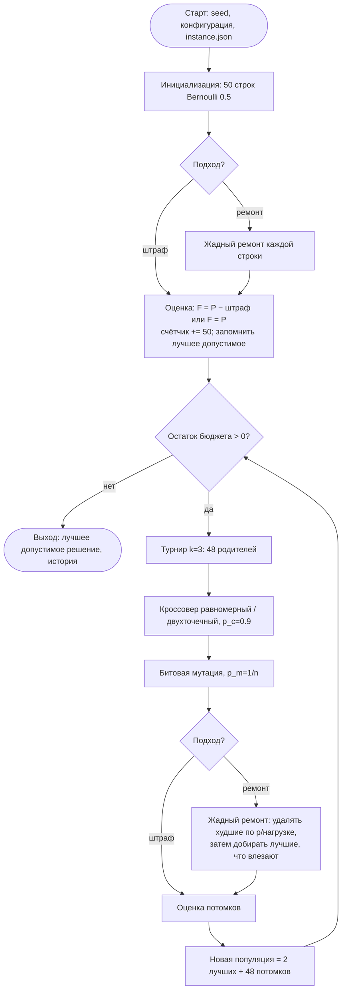
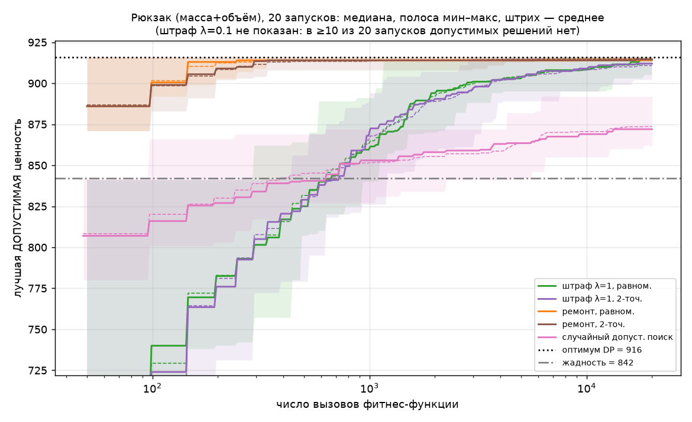
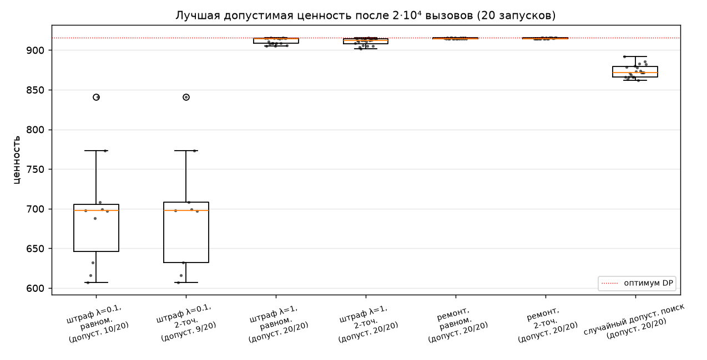
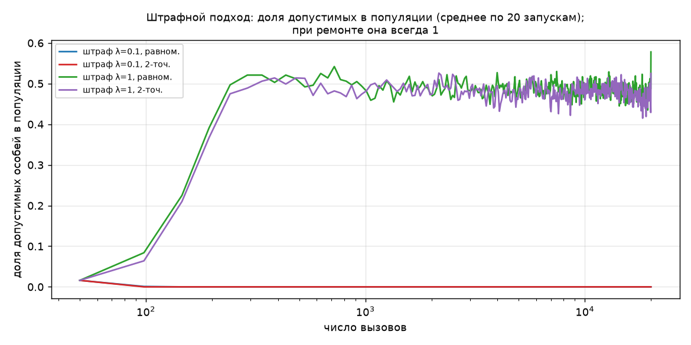

# Отчёт по лабораторной работе № 2
## Генетический алгоритм для двумерного рюкзака (масса + объём)

Воспроизведение: `make all`.

## 1. Постановка задачи и индивидуальный вариант

N = 20, Q = 2, Y = 26 → V = 1 + ((17·20 + 7·2 + 26) mod 20) = 1.

Вариант 1: рюкзак с двумя ограничениями — масса и объём, основное представление —
бинарная строка.

Есть n = 40 предметов, у каждого целые масса wᵢ, объём vᵢ и ценность pᵢ.
Нужно выбрать подмножество максимальной суммарной ценности, которое не превышает
грузоподъёмность W и вместимость V.

### Входные данные и процедура генерации

Экземпляр синтетический (`lab2/data_gen.py`, seed = 527, сохранён в
`lab2/data/instance.json`):

- wᵢ ~ U{5, …, 60}, vᵢ ~ U{5, …, 60}, независимо;
- pᵢ = max(1, round(0.8·wᵢ + 0.8·vᵢ + εᵢ)), где εᵢ ~ N(0, 12²);
- W = round(0.35·Σw), V = round(0.35·Σv).

Ценность скоррелирована с нагрузкой и зашумлена. Удельная ценность предметов
поэтому близка, и жадный выбор по удельной ценности ошибается. Ёмкости около 35%
сумм выбраны так, чтобы точная DP по двум ёмкостям считалась быстро:
(W+1)(V+1)·n ≈ 8.5·10⁶ ячеек, доли секунды.

Полная таблица предметов:

40 предметов (results/instance.md)

<!-- BEGIN include: results/instance.md -->
| id | масса | объём | ценность | p/(w/W+v/V) |
|---|---|---|---|---|
| 0 | 55 | 60 | 102 | 408.1 |
| 1 | 33 | 42 | 50 | 307.6 |
| 2 | 27 | 25 | 51 | 449.8 |
| 3 | 31 | 39 | 55 | 362.5 |
| 4 | 55 | 19 | 60 | 365.4 |
| 5 | 23 | 26 | 31 | 291.3 |
| 6 | 60 | 29 | 72 | 366.6 |
| 7 | 34 | 23 | 57 | 455.9 |
| 8 | 32 | 58 | 70 | 361.3 |
| 9 | 28 | 53 | 46 | 264.0 |
| 10 | 50 | 57 | 58 | 249.6 |
| 11 | 39 | 34 | 71 | 445.5 |
| 12 | 18 | 15 | 26 | 360.6 |
| 13 | 57 | 26 | 50 | 272.7 |
| 14 | 34 | 30 | 34 | 243.4 |
| 15 | 51 | 53 | 78 | 344.7 |
| 16 | 17 | 47 | 63 | 460.6 |
| 17 | 25 | 14 | 43 | 500.9 |
| 18 | 31 | 31 | 59 | 437.1 |
| 19 | 22 | 24 | 35 | 350.1 |
| 20 | 23 | 51 | 78 | 491.4 |
| 21 | 24 | 45 | 82 | 552.4 |
| 22 | 14 | 26 | 37 | 429.9 |
| 23 | 20 | 36 | 65 | 539.1 |
| 24 | 26 | 43 | 78 | 524.3 |
| 25 | 23 | 25 | 40 | 383.4 |
| 26 | 42 | 29 | 52 | 334.0 |
| 27 | 38 | 57 | 92 | 448.3 |
| 28 | 26 | 9 | 29 | 373.5 |
| 29 | 25 | 52 | 60 | 362.9 |
| 30 | 9 | 24 | 8 | 113.4 |
| 31 | 16 | 45 | 35 | 268.5 |
| 32 | 41 | 12 | 36 | 305.4 |
| 33 | 33 | 35 | 51 | 344.9 |
| 34 | 10 | 34 | 29 | 309.3 |
| 35 | 15 | 58 | 71 | 457.3 |
| 36 | 31 | 7 | 20 | 235.9 |
| 37 | 40 | 22 | 49 | 358.9 |
| 38 | 59 | 13 | 56 | 348.5 |
| 39 | 25 | 38 | 71 | 521.8 |
| Σ | 1262 | 1366 | 2150 | |

Корреляция Пирсона: p~w = 0.409, p~v = 0.670, p~(w+v) = 0.780. W = 442 (35.0% Σw), V = 478 (35.0% Σv).
<!-- END include -->

## 2. Пространство решений, целевая функция, ограничения

- Пространство решений: {0, 1}⁴⁰, всего 2⁴⁰ ≈ 1.1·10¹² строк.
- Цель: max P(x) = Σ pᵢxᵢ.
- Ограничения:
  - M(x) = Σ wᵢxᵢ ≤ W = 442;
  - Vol(x) = Σ vᵢxᵢ ≤ V = 478.
- Нарушения: e_M(x) = max(0, M(x) − W), e_V(x) = max(0, Vol(x) − V).
  Решение допустимо, если e_M = e_V = 0.

## 3. Представление особи

- Генотип: бинарная строка x ∈ {0,1}⁴⁰, где xᵢ = 1 означает «предмет i взят».
- Фенотип: набор предметов {i : xᵢ = 1} с суммарными массой, объёмом и ценностью.
- Декодирование: тождественное (бит = решение по предмету). При подходе
  «ремонт» перед оценкой строка проходит через жадный ремонт, и исправленная строка
  записывается обратно в популяцию (ламарковская схема).

Почему кодирование отражает структуру решения (эксп. 1 задания). Решение
рюкзака — это подмножество предметов, а бинарная строка длины n взаимно однозначно
кодирует подмножества. Любое решение представимо ровно одной строкой, и любая
строка — некоторое решение, возможно недопустимое. Ограничения линейны по битам,
поэтому нагрузку и ценность можно считать скалярным произведением. Обе операции
вариации имеют прямой смысл: мутация бита добавляет или убирает предмет, кроссовер
комбинирует наборы родителей.

## 4. Алгоритм, операторы и параметры

Тот же генерационный цикл, что в ЛР1 (`eaga/core.py: run_ga`, минимизация cost = −F):

1. Инициализация: каждый бит = 1 с вероятностью 0.5. При ремонте строки сразу
   исправляются.
2. Оценка. Один вызов = одна строка, счётчик встроен в `CountedFunction`.
3. Пока бюджет не исчерпан:
   - турнир k = 3 выбирает 48 родителей;
   - пары скрещиваются с p_c = 0.9 (равномерный или двухточечный кроссовер);
   - битовая мутация с p_m = 1/n = 0.025;
   - при ремонте — ремонт;
   - оценка;
   - новая популяция = 2 лучших (элита) + 48 потомков.
4. Результат: лучшее допустимое решение среди всех оценённых. Его отслеживает
   фитнес-функция (`KnapsackObjective`), поэтому штрафной ГА не может выдать
   недопустимое решение за ответ.

Обработка ограничений.

- (a) Штраф, пропорциональный нарушению:
  F(x) = P(x) − λ·(ρ_M·e_M(x) + ρ_V·e_V(x)), где
  - ρ_M = maxᵢ pᵢ/wᵢ = 4.733 и ρ_V = maxᵢ pᵢ/vᵢ = 4.308 — наибольшая ценность единицы ресурса;
  - сравниваются два коэффициента: λ = 0.1 (слабый) и λ = 1 (сильный).

  λ = 1 выбран как «естественная» граница: при дробных предметах превышение было бы
  невыгодным.
- (b) Жадный ремонт (`lab2/constraints.py: GreedyRepair`). Эффективность
  предмета: eᵢ = pᵢ / (wᵢ/W + vᵢ/V), то есть ценность на единицу нормированной
  нагрузки.
  1. Пока решение недопустимо, удаляется взятый предмет с наименьшей eᵢ.
  2. Затем невзятые предметы перебираются по убыванию eᵢ, и каждый добавляется,
     если помещается.

Таблица параметров (`lab2/configs/*.json`):

| параметр | значение |
|---|---|
| размер популяции | 50 |
| элита | 2 (потомков 48 за поколение) |
| селекция | турнир k = 3 с возвращением |
| кроссовер | равномерный (`*_uniform`) / двухточечный (`*_two_point`), p_c = 0.9 |
| мутация | битовая, p_m = 1/n = 1/40 на бит |
| инициализация | Bernoulli(0.5) на бит |
| ограничения | штраф λ = 0.1 (`pen01_*`), λ = 1 (`pen1_*`); жадный ремонт, ламарковский (`repair_*`) |
| бюджет / остановка | 2·10⁴ вызовов фитнес-функции (≈ 416 поколений) |
| seed | 0…19, одинаковые для всех конфигураций |
| случайный допустимый поиск | 2·10⁴ решений: случайный порядок предметов, добавлять, пока помещается |
| жадная эвристика | детерминированно: по убыванию eᵢ, добавлять, если помещается |
| точный оптимум | DP по (масса, объём), O(n·W·V) |

## 5. Блок-схема

## 6. Обоснование операторов и сохранение допустимости

Почему после каждого оператора допустимость сохраняется или восстанавливается:

| оператор | сохраняет допустимость? | почему / что происходит |
|---|---|---|
| инициализация Bernoulli(0.5) | нет | ожидаемая нагрузка 50% сумм > 35% ёмкости; при штрафе допустимых в начальной популяции почти нет (≈ 1.6% в среднем, см. `feasibility.png`) |
| равномерный кроссовер | нет | потомок берёт часть предметов одного родителя и часть другого; сумма нагрузок может превысить ёмкость, даже если оба родителя допустимы (пример «Недопустимое 2» ниже — для двухточечного) |
| двухточечный кроссовер | нет | то же: отрезок одного родителя + остальное от другого |
| битовая мутация 0→1 | нет | добавление предмета к почти полному рюкзаку (оптимум заполнен на 99.8% / 98.5%) почти всегда нарушает ограничение (пример «Недопустимое 1») |
| битовая мутация 1→0 | да | удаление предмета не увеличивает нагрузку (все wᵢ, vᵢ > 0) |
| жадный ремонт | восстанавливает всегда | фаза 1 удаляет предметы, пока нарушение не исчезнет; это конечно, т.к. пустой набор допустим. Фаза 2 добавляет предмет только если он помещается по обоим ресурсам. Итог допустим и максимален по включению (проверено тестом `test_repair_always_feasible_and_maximal` и assert в фитнес-функции на каждом вызове) |
| штраф | не восстанавливает | недопустимые особи остаются в популяции и ранжируются ниже; допустимость зависит от силы λ (раздел 8) |

Почему выбраны именно эти операторы:

- Битовая мутация с p_m = 1/n меняет в среднем один предмет: это минимальный шаг
  в пространстве подмножеств. Это специализированный под бинарное представление
  оператор.
- Равномерный и двухточечный кроссовер — содержательно разные варианты.
  Двухточечный сохраняет смежные гены, но у рюкзака порядок предметов произволен,
  и сцепления соседних генов нет. Поэтому равномерный кроссовер априори
  обоснованнее. Эксперимент проверяет, важно ли это на практике.
- Ремонт использует структуру задачи: ценность на нормированную нагрузку двух
  ресурсов. Это разумная мера «полезности» предмета при двух ограничениях.
- Штраф пропорционален величине нарушения, а не только факту нарушения. Поэтому
  у недопустимых решений есть градиент к допустимой области.

### Примеры допустимых и недопустимых решений (эксп. 2 задания)

<!-- BEGIN include: results/examples.md -->
## Примеры решений (вычислено `lab2/report_tables.py`)

Допустимое 1 — жадная эвристика

- предметы (13 шт.): 2, 7, 11, 16, 17, 20, 21, 23, 24, 27, 35, 36, 39
- масса: 344 ≤ W = 442 → превышение 0
- объём: 478 ≤ V = 478 → превышение 0
- ценность P = 842; допустимо

Допустимое 2 — точный оптимум DP

- предметы (14 шт.): 2, 4, 6, 7, 11, 17, 18, 20, 21, 22, 23, 24, 27, 39
- масса: 441 ≤ W = 442 → превышение 0
- объём: 471 ≤ V = 478 → превышение 0
- ценность P = 916; допустимо

Недопустимое 1 — оптимум DP после инверсии бита 12 (0→1) мутацией

- предметы (15 шт.): 2, 4, 6, 7, 11, 12, 17, 18, 20, 21, 22, 23, 24, 27, 39
- масса: 459 > W = 442 → превышение 17
- объём: 486 > V = 478 → превышение 8
- ценность P = 942; НЕДОПУСТИМО
- штраф при λ=0.1: 0.1·(4.7333·17 + 4.3077·8) = 11.49; F = 942 − 11.49 = 930.51
- штраф при λ=1: 1·(4.7333·17 + 4.3077·8) = 114.93; F = 942 − 114.93 = 827.07

Недопустимое 2 — потомок двухточечного кроссовера родителей «Допустимое 1» и «Допустимое 2» (rng seed 0, попытка 2)

- предметы (14 шт.): 2, 4, 6, 7, 11, 16, 17, 20, 21, 22, 23, 24, 27, 39
- масса: 427 ≤ W = 442 → превышение 0
- объём: 487 > V = 478 → превышение 9
- ценность P = 920; НЕДОПУСТИМО
- штраф при λ=0.1: 0.1·(4.7333·0 + 4.3077·9) = 3.88; F = 920 − 3.88 = 916.12
- штраф при λ=1: 1·(4.7333·0 + 4.3077·9) = 38.77; F = 920 − 38.77 = 881.23

Недопустимое 3 — лучшая по штрафованной фитнес-функции особь финальной популяции, pen1_uniform, seed 2 (таких запусков 7/20)

- предметы (14 шт.): 2, 4, 7, 11, 16, 17, 18, 20, 21, 23, 24, 27, 38, 39
- масса: 443 > W = 442 → превышение 1
- объём: 476 ≤ V = 478 → превышение 0
- ценность P = 926; НЕДОПУСТИМО
- штраф при λ=0.1: 0.1·(4.7333·1 + 4.3077·0) = 0.47; F = 926 − 0.47 = 925.53
- штраф при λ=1: 1·(4.7333·1 + 4.3077·0) = 4.73; F = 926 − 4.73 = 921.27
<!-- END include -->

Примеры показывают главное свойство штрафа. В «Недопустимом 2» при λ = 0.1 и в
«Недопустимом 3» даже при λ = 1 штрафованная фитнес-функция недопустимого решения
выше ценности оптимума 916. Значит, для такой F глобальный максимум лежит вне
допустимой области.

## 7. Результаты 20 независимых запусков

Для каждой конфигурации 20 запусков (seed 0…19), бюджет ровно 2·10⁴ вызовов. Данные по
запускам лежат в `results/<конфигурация>/runs.csv`: лучшая допустимая ценность, вызовы,
время, допустима ли финальная лучшая особь, доли допустимых, вызов нахождения
оптимума, генотипы. История по поколениям — в `results/<конфигурация>/history.csv`.

Бенчмарки (`results/benchmarks.json`):

- точный оптимум DP = 916, найден за доли секунды, таблица 8.5·10⁶ ячеек.
  Правильность DP проверена полным перебором на малых экземплярах
  (`test_dp_matches_brute_force`);
- жадная эвристика = 842, gap 8.08%;
- у задачи два различных оптимальных набора ценности 916. ГА находил оба,
  см. `runs.csv`.

<!-- BEGIN include: results/summary.md -->
Оптимум (DP) = 916; жадная эвристика = 842 (gap 8.08%).

Статистики ценности и gap считаются по запускам, в которых найдено хотя бы одно допустимое решение (столбец «допуст. найдено»).

| конфигурация | запусков | допуст. найдено | best | mean | median | std | worst | gap mean, % | gap median, % | gap worst, % | найден оптимум | финальный лучший допустим | доля допуст. в финальной поп. | доля допуст. среди вычисленных | медиана вызова нахождения оптимума | вызовов | время, с |
|---|---|---|---|---|---|---|---|---|---|---|---|---|---|---|---|---|---|
| pen01_uniform | 20 | 10 | 841 | 695.9 | 697.5 | 71.17 | 607 | 24.03 | 23.85 | 33.73 | 0/20 | 0.00 | 0.00 | 0.00 | — | 20000 | 0.04 |
| pen01_two_point | 20 | 9 | 841 | 696.8 | 698.0 | 75.44 | 607 | 23.93 | 23.80 | 33.73 | 0/20 | 0.00 | 0.00 | 0.00 | — | 20000 | 0.05 |
| pen1_uniform | 20 | 20 | 916 | 911.9 | 914.5 | 3.94 | 905 | 0.45 | 0.16 | 1.20 | 2/20 | 0.65 | 0.58 | 0.47 | 10256 | 20000 | 0.04 |
| pen1_two_point | 20 | 20 | 916 | 910.8 | 912.0 | 4.19 | 902 | 0.57 | 0.44 | 1.53 | 1/20 | 0.60 | 0.53 | 0.47 | 2847 | 20000 | 0.05 |
| repair_uniform | 20 | 20 | 916 | 914.8 | 914.0 | 0.95 | 914 | 0.13 | 0.22 | 0.22 | 7/20 | 1.00 | 1.00 | 1.00 | 2420 | 20000 | 0.24 |
| repair_two_point | 20 | 20 | 916 | 914.9 | 914.5 | 0.97 | 914 | 0.12 | 0.16 | 0.22 | 8/20 | 1.00 | 1.00 | 1.00 | 363 | 20000 | 0.24 |
| random_feasible | 20 | 20 | 892 | 873.6 | 872.0 | 8.13 | 862 | 4.63 | 4.80 | 5.90 | 0/20 | 1.00 | 1.00 | 1.00 | — | 20000 | 0.24 |
<!-- END include -->

Значение столбцов:

- «финальный лучший допустим» — доля запусков, где лучшая по F особь последнего
  поколения допустима;
- «доля допуст. в финальной поп.» — средняя по запускам доля допустимых особей
  в последнем поколении;
- «доля допуст. среди вычисленных» — доля допустимых среди всех 2·10⁴ оценённых
  строк;
- время в секундах на один запуск. Ремонт и случайный поиск в несколько раз медленнее
  из-за поэлементного цикла на Python, но бюджет вызовов у всех одинаков.

Графики:

- `results/convergence.png` — лучшая допустимая ценность по вызовам: медиана,
  среднее, мин–макс;
- `results/boxplot_final.png` — финальные значения;
- `results/feasibility.png` — доля допустимых в популяции при штрафе.

## 8. Анализ результатов

Проверка значимости — двусторонний перестановочный тест разности средних по
лучшей ценности (20 000 перестановок, `results/comparisons.md`):

<!-- BEGIN include: results/comparisons.md -->
| A | B | mean A | mean B | найден оптимум A | найден оптимум B | p-value (перест. тест, 20000 перест.) |
|---|---|---|---|---|---|---|
| repair_uniform | repair_two_point | 914.80 | 914.90 | 7/20 | 8/20 | 0.8711 |
| pen1_uniform | pen1_two_point | 911.85 | 910.80 | 2/20 | 1/20 | 0.4373 |
| pen1_uniform | repair_uniform | 911.85 | 914.80 | 2/20 | 7/20 | 0.0024 |
| pen1_two_point | repair_two_point | 910.80 | 914.90 | 1/20 | 8/20 | 0.0000 |
| repair_uniform | random_feasible | 914.80 | 873.60 | 7/20 | 0/20 | 0.0000 |
<!-- END include -->

(p-value 0.0000 означает < 5·10⁻⁵: ни одна из 20 000 перестановок не дала разность
не меньше наблюдаемой.)

### 8.1. Штраф против ремонта (эксп. 3 задания)

- Ремонт — лучший подход по всем показателям:
  - средний gap 0.12–0.13%, худший запуск 914 (gap 0.22%);
  - оптимум найден в 7/20 (равномерный) и 8/20 (двухточечный) запусках;
  - все оценённые решения допустимы.

  Разница со штрафом λ = 1 значима (p = 0.0024 и p < 5·10⁻⁵). Ремонт — сильная
  эвристика сама по себе: уже в начальной популяции медиана лучшего решения 886,
  выше жадности (842) (`history.csv`, поколение 0). В одном запуске (seed 18,
  общий для обеих repair-конфигураций) оптимум найден прямо в начальной
  популяции, на 45-м вызове. В остальных 6 и 7 запусках оптимум найден в ходе
  эволюции (вызовы 247–11216 и 253–15700).
- Штраф λ = 1:
  - средний gap 0.45–0.57%, оптимум найден в 2/20 и 1/20 запусков;
  - доля допустимых в популяции держится около 0.5;
  - в 7/20 (равномерный) и 8/20 (двухточечный) запусков лучшая по F финальная
    особь недопустима: например, ценность 926 при превышении массы на 1
    («Недопустимое 3»).

  Это прямое следствие пропорционального штрафа в 0/1-задаче. Превышение на одну
  единицу стоит λ·ρ_M ≈ 4.7 ценности, а чтобы его устранить, приходится выбросить
  целый предмет ценностью 12–92. Поэтому ответом ГА считается лучшее допустимое
  решение за всю историю, а не лучшая финальная особь.
- Штраф λ = 0.1: полный провал:
  - во всех 20 запусках финальная популяция целиком недопустима (доля 0.00);
  - лучшая особь — почти все предметы, ценность 2142 из 2150;
  - допустимые решения встречались только в 10 (равномерный) и 9 (двухточечный)
    запусках из 20 и только в поколениях 0–1, то есть в случайной начальной
    популяции; лучшее из них 841 < жадности.

  Слабый штраф делает перегрузку выгодной (ср. «Недопустимое 1»: F = 930.5 > 916).

### 8.2. Равномерный против двухточечного кроссовера (эксп. 4 задания)

Значимой разницы нет. При ремонте средние 914.80 и 914.90 (p = 0.87), оптимум в 7
и 8 запусках. При λ = 1 средние 911.85 и 910.80 (p = 0.44). Медиана вызова
нахождения оптимума у ремонта сильно отличается (2420 против 363), но считается
всего по 7 и 8 успешным запускам, и разброс внутри каждой группы велик (см. выше).
Вывод: на этом экземпляре выбор кроссовера несущественен по сравнению с выбором
способа работы с ограничениями. Это согласуется с тем, что у рюкзака порядок генов
произволен, и двухточечный кроссовер не получает преимущества от сцепления генов.

### 8.3. Сравнение с эвристикой и случайным допустимым поиском (эксп. 6 задания)

| метод | лучшая ценность (медиана по 20 запускам) | gap медианы |
|---|---|---|
| точная DP | 916 | 0 |
| ГА + ремонт (равномерный) | 914.0 | 0.22% |
| ГА + штраф λ = 1 (равномерный) | 914.5 | 0.16% |
| случайный допустимый поиск, 2·10⁴ решений | 872.0 | 4.80% |
| жадная эвристика (1 решение) | 842 | 8.08% |

ГА с ремонтом или с штрафом λ = 1 значимо лучше случайного допустимого поиска при
равном бюджете (p < 5·10⁻⁵) и лучше жадности в каждом из 20 запусков. Худший
запуск ГА с ремонтом — 914, худший с λ = 1 — 905 и 902. Медиана у λ = 1 даже
немного выше, но среднее ниже (911.85 против 914.80, p = 0.0024), а разброс
в 4 раза больше (std 3.94 против 0.95).

### 8.4. Почему ремонт часто останавливается на 914

В 11/20 (равномерный) и 10/20 (двухточечный) запусках с ремонтом итог — 914. Это два
разных набора, и каждый отличается от оптимальных на 3–4 предмета. Ламарковский
ремонт возвращает каждую особь в «жадно дополненное» решение. Чтобы перейти от 914
к 916, нужно одновременно заменить несколько предметов, а одна мутация бита
вместе с ремонтом обычно возвращает строку в тот же локальный оптимум. Это
проявление преждевременной сходимости: на `convergence.png` медиана ремонта
выходит на плато 914 уже к 242-му вызову (5-е поколение).

### 8.5. Лучшее найденное решение (эксп. 5 задания)

<!-- BEGIN include: results/best_solution.md -->
## Лучшее решение ГА

Конфигурация `repair_two_point`, seed 18; найдено на вызове 45 из 20000 (в начальной популяции, после ремонта). Ценность 916 при оптимуме DP 916 (gap 0.00%). Совпадает с решением DP: да.

| id | масса | объём | ценность | p/(w/W+v/V) |
|---|---|---|---|---|
| 2 | 27 | 25 | 51 | 449.8 |
| 4 | 55 | 19 | 60 | 365.4 |
| 6 | 60 | 29 | 72 | 366.6 |
| 7 | 34 | 23 | 57 | 455.9 |
| 11 | 39 | 34 | 71 | 445.5 |
| 17 | 25 | 14 | 43 | 500.9 |
| 18 | 31 | 31 | 59 | 437.1 |
| 20 | 23 | 51 | 78 | 491.4 |
| 21 | 24 | 45 | 82 | 552.4 |
| 22 | 14 | 26 | 37 | 429.9 |
| 23 | 20 | 36 | 65 | 539.1 |
| 24 | 26 | 43 | 78 | 524.3 |
| 27 | 38 | 57 | 92 | 448.3 |
| 39 | 25 | 38 | 71 | 521.8 |
| итого (14 шт.) | 441 | 471 | 916 | |
| ёмкость | 442 | 478 | | |
| заполнение | 99.8% | 98.5% | | |
<!-- END include -->

Оптимум включает предметы 4, 6, 18, 22, которые жадность пропускает. Среди них 4 и 6
имеют низкую эффективность ≈ 366. Вместо них жадность берёт предметы 16, 35, 36. Жадность заполняет объём
полностью (478/478), но массу только на 344/442 (77.8%). Оптимум сбалансированно
загружает оба ресурса.

## 9. Выводы о влиянии операторов и способа обработки ограничений

1. Способ работы с ограничениями важнее выбора кроссовера. Переход от штрафа
   λ = 1 к ремонту поднял долю запусков с точным оптимумом с 1–2/20 до 7–8/20 и
   уменьшил разброс в 4 раза. Смена кроссовера при фиксированном способе значимого
   эффекта не дала (p = 0.44 и 0.87).
2. Коэффициент штрафа критичен. При λ = 0.1 максимум F лежит вне допустимой
   области, и ГА уходит в перегрузку (0 допустимых в финале). При λ = 1 поиск
   работает, но граница не «запирается»: в 35–40% запусков финальный лидер
   недопустим. Пропорциональный штраф в 0/1-задаче не гарантирует допустимость
   максимума F ни при каком «естественном» λ.
3. Ремонт силён, но склонен к преждевременной сходимости: плато 914 в половине
   запусков. При большем бюджете стоит ослабить ламарковость (записывать
   отремонтированную строку в популяцию с вероятностью < 1), добавить мутацию
   «обмен предмета» или рестарты.

## 10. Почему результат хороший, приемлемый или недостаточный

Для поставленной задачи результат ГА с ремонтом хороший.

- Каждый из 20 запусков дал допустимое решение не хуже 914 (gap ≤ 0.22%) при
  бюджете 2·10⁴ вызовов. Это ≈ 1.8·10⁻⁸ от мощности пространства 2⁴⁰.
- Точный оптимум найден в 7–8 запусках из 20.
- Результат значимо лучше обоих простых бенчмарков: жадность 8.08%, случайный
  допустимый поиск 4.80% по медиане.

ГА со штрафом λ = 1 приемлем (gap ≤ 1.53%, но больше разброс). Штраф λ = 0.1
недостаточен: решения недопустимы.

Ограничения вывода:

- Это экспериментальный результат на одном экземпляре и 20 запусках. Строгой
  гарантии оптимальности ГА не даёт: гарантирует только DP.
- Для этого размера (n = 40, W, V < 500) точная DP решает задачу за доли
  секунды, и ГА здесь не нужен практически. Эволюционный подход оправдан, когда
  DP становится неподъёмной: время и память O(n·W·V) растут с ёмкостями и
  экспоненциально с числом ограничений. Например, при десятках ресурсов или
  ёмкостях порядка 10⁶. Именно там ценно, что ГА с ремонтом стабильно держит
  gap < 0.3%.
