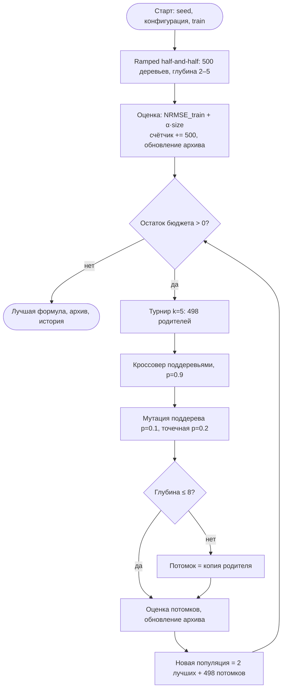
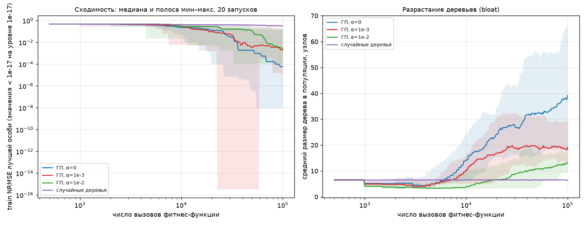
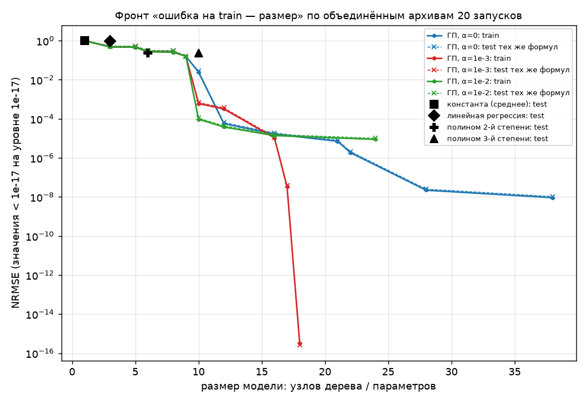

# Отчёт по лабораторной работе № 3
## Символьная регрессия генетическим программированием (трек B)

Воспроизведение: `make lab3 reports`.

## 1. Постановка задачи и вариант

N = 20, Q = 2, Y = 26 → V = 1. Трек B, вариант 1: символьная регрессия по
синтетическим данным, объект эволюции — дерево арифметического выражения.

По выборке точек (x0, x1, y) нужно найти формулу y ≈ f(x0, x1), которая точна и при
этом как можно проще.

Данные (`lab3/data_gen.py`, seed 327):

- истинная зависимость y = x0² + x0·sin(x1) + 0.5·x1, без шума;
- train: 200 точек из U[−3, 3]²;
- test: 200 других точек из того же распределения, при эволюции не используется;
- extrapolation: 200 точек из U[−5, 5]², чтобы проверить, выучена ли сама
  зависимость, а не её форма внутри квадрата.

Истинная формула алгоритму, конечно, не известна. Она нужна только для оценки.

## 2. Пространство решений, цель, ограничения

- Пространство решений: все синтаксически корректные выражения над языком из
  раздела 3 глубиной не больше 8.
- Качество: NRMSE(f) = RMSE(f(X), y) / std(y). Значение 1 соответствует
  константному прогнозу средним, 0 — точному совпадению.
- Цель: min NRMSE_train(f) + α·size(f), где size — число узлов дерева.
  Это одна сложная цель со штрафом за сложность, который трек B требует
  для формул.
- Ограничение: глубина ≤ 8. Если оператор нарушает его, потомок заменяется копией
  родителя.
- Если формула даёт nan или inf, её ошибка принимается равной 10¹⁰.

## 3. Представление

- Язык:
  - функции: +, −, ×, ÷ (защищённое: при |b| ≤ 10⁻⁶ результат 1), sin, cos;
  - терминалы: x0, x1 и случайная константа из U[−2, 2]. Константа выбирается
    с вероятностью 1/3, каждая переменная — с вероятностью 1/3.
- Генотип: дерево в префиксной записи, список токенов. Например,
  `["add", "mul", "x0", "x0", "sin", "x1"]` = x0·x0 + sin(x1).
- Фенотип: функция f(x0, x1).
- Декодирование: рекурсивное вычисление сразу на всей выборке (numpy). Для печати
  поддеревья без переменных сворачиваются в число.

Защищённое деление и ограниченный набор функций делают любое синтаксически
корректное дерево вычислимым на любых входах. Поэтому корректность сводится к
синтаксической.

## 4. Алгоритм и параметры

Генерационный цикл из общего ядра (`eaga/core.py`), популяция хранится как массив
деревьев:

1. Инициализация ramped half-and-half: глубины 2–5, половина деревьев методом grow,
   половина методом full.
2. Оценка. Каждое дерево — один вызов, счётчик встроен в `CountedFunction`.
   При оценке каждое дерево заносится во внешний архив: для каждого размера
   хранится формула с наименьшей ошибкой на train.
3. Пока бюджет не исчерпан:
   - турнир k = 5;
   - кроссовер поддеревьями с p_c = 0.9;
   - мутация поддерева с вероятностью 0.1;
   - точечная мутация с вероятностью 0.2;
   - элитизм: 2 лучших переходят без изменений.
4. Ответ — особь с лучшим cost за всю историю. Отдельно сохраняется архив, из
   которого строится фронт «ошибка — размер».

| параметр | значение |
|---|---|
| размер популяции | 500 (элита 2, 498 потомков за поколение) |
| бюджет | 10⁵ вызовов = 200 поколений |
| селекция | турнир k = 5 |
| кроссовер | обмен поддеревьями, p_c = 0.9, внутренний узел выбирается с вероятностью 0.9 |
| мутация поддерева | p = 0.1, новое поддерево grow глубины ≤ 4 |
| точечная мутация | p = 0.2: функция → другая той же арности; переменная → терминал; константа += N(0, 0.3²) |
| максимальная глубина | 8 |
| штраф α | 0 (`alpha0`), 10⁻³ (`alpha1e-3`, база), 10⁻² (`alpha1e-2`) |
| критерий «решено» (задан до запусков) | NRMSE на test < 0.01 |
| seed | 0…19, общие для всех конфигураций |

Механизмы, которых не было в ЛР1–2:
- эволюция структуры решения (ГП);
- внешний архив недоминируемых по паре (ошибка, размер) решений;
- штраф за сложность.

## 5. Блок-схема

## 6. Обоснование операторов и синтаксическая корректность

- Кроссовер поддеревьями. Поддерево в префиксной записи — непрерывный отрезок
  `[i, subtree_end(i))`. Обмен двумя такими отрезками всегда даёт корректное
  дерево: на место одного полного выражения встаёт другое полное выражение.
  Узел выбирается внутренним с вероятностью 0.9 (рекомендация Коза), иначе
  кроссовер в основном обменивался бы листьями.
- Мутация поддерева заменяет отрезок новым корректным деревом. Она вносит
  структуры, которых нет в популяции.
- Точечная мутация меняет функцию на функцию той же арности, терминал на
  терминал, а константу сдвигает на гауссов шум. Число аргументов не меняется,
  поэтому корректность сохраняется. Это единственный механизм тонкой настройки
  констант, и его ограниченность видна в результатах (раздел 8.2).
- Ограничение глубины проверяется после каждого оператора. Синтаксическая
  корректность и ограничение глубины проверены тестом
  `test_operators_keep_trees_valid` на 3000 случайных применений всех операторов.
- Турнир k = 5 не зависит от масштаба ошибки, которая меняется от 1 до 10⁻¹⁶.
  Давление выше, чем в ЛР1–2: популяция большая, а структура дерева
  восстанавливается медленно.
- Штраф α·size ограничивает разрастание деревьев (bloat). Без него деревья растут
  за счёт интронов, то есть фрагментов, не влияющих на результат.

## 7. Результаты 20 запусков

Данные по каждому запуску — в `results/<конфигурация>/runs.csv` (там же формулы),
история — в `history.csv`, архивы — в `extra.csv`.

<!-- BEGIN include: results/summary.md -->
| конфигурация | запусков | test best | test mean | test median | test std | test worst | решено (test < 0.01) | точно (test < 1e-6) | train median | экстраполяция median | размер median | размер max | вызовов | время, с |
|---|---|---|---|---|---|---|---|---|---|---|---|---|---|---|
| alpha0 | 20 | 1.05e-08 | 3.11e-02 | 6.38e-05 | 5.25e-02 | 1.57e-01 | 13/20 | 2/20 | 5.85e-05 | 1.24e-04 | 40 | 72 | 100000 | 7.6 |
| alpha1e-3 | 20 | 1.21e-05 | 3.03e-02 | 2.35e-03 | 6.53e-02 | 2.19e-01 | 16/20 | 0/20 | 2.05e-03 | 1.37e-03 | 14 | 31 | 100000 | 7.0 |
| alpha1e-2 | 20 | 4.35e-05 | 2.73e-02 | 3.04e-03 | 5.68e-02 | 1.58e-01 | 15/20 | 0/20 | 2.66e-03 | 1.78e-03 | 10 | 13 | 100000 | 5.4 |
| random_search | 20 | 3.14e-01 | 3.62e-01 | 3.44e-01 | 5.11e-02 | 4.54e-01 | 0/20 | 0/20 | 3.03e-01 | 1.96e-01 | 7 | 13 | 100000 | 5.6 |
<!-- END include -->

Базовые модели, обученные МНК на train (`results/baselines.md`):

<!-- BEGIN include: results/baselines.md -->
| модель | параметров | train NRMSE | test NRMSE | экстраполяция NRMSE |
|---|---|---|---|---|
| константа (среднее) | 1 | 1.0000 | 1.0236 | 1.1624 |
| линейная регрессия | 3 | 0.9264 | 0.9559 | 1.1657 |
| полином 2-й степени | 6 | 0.2239 | 0.2348 | 0.4607 |
| полином 3-й степени | 10 | 0.2200 | 0.2355 | 0.4866 |
<!-- END include -->

Перестановочный тест разности средних, 20 000 перестановок (`results/comparisons.md`):

<!-- BEGIN include: results/comparisons.md -->
| A | B | показатель | median A | median B | p-value |
|---|---|---|---|---|---|
| alpha0 | alpha1e-3 | log10 test NRMSE | 6.38e-05 | 0.00235 | 0.0218 |
| alpha0 | alpha1e-3 | размер дерева | 39.5 | 14 | 0.0000 |
| alpha1e-3 | alpha1e-2 | log10 test NRMSE | 0.00235 | 0.00304 | 0.8086 |
| alpha1e-3 | alpha1e-2 | размер дерева | 14 | 10 | 0.0001 |
| alpha0 | alpha1e-2 | log10 test NRMSE | 6.38e-05 | 0.00304 | 0.0319 |
| alpha0 | alpha1e-2 | размер дерева | 39.5 | 10 | 0.0000 |
| alpha1e-3 | random_search | log10 test NRMSE | 0.00235 | 0.344 | 0.0000 |
| alpha1e-3 | random_search | размер дерева | 14 | 7 | 0.0000 |
<!-- END include -->

p-value 0.0000 означает < 5·10⁻⁵.

Графики:
- `results/convergence.png` — ошибка лучшей особи и средний размер дерева по вызовам;
- `results/complexity_front.png` — фронт «ошибка — размер» и базовые модели;
- `results/boxplot_test.png`, `results/boxplot_size.png` — финальные значения.

## 8. Анализ

### 8.1. Сравнение с базовыми моделями

Линейная регрессия почти бесполезна (test 0.956): зависимость существенно
нелинейна. Полином 2-й степени даёт 0.235, полином 3-й степени лучше не становится
(0.2355), потому что не может выразить sin(x1).

ГП с любым α выигрывает у полинома 2-й степени по медиане на два порядка. Даже
худший запуск каждой конфигурации ГП лучше полинома: 0.157, 0.219 и 0.158 против
0.235. Случайные деревья с тем же бюджетом (медиана 0.344) хуже полинома. Значит,
результат получен эволюцией, а не перебором.

На экстраполяции разница ещё заметнее. Формулы с найденной правильной структурой
сохраняют малую ошибку: медиана 1.4·10⁻³ при α = 10⁻³. Полином 2-й степени
ухудшается с 0.235 до 0.461. NRMSE на экстраполяции нормирован на std(y) этой
выборки (7.44 против 2.74 на test), поэтому сравнивать здесь стоит модели между
собой, а не test с экстраполяцией.

### 8.2. Влияние штрафа за сложность (однофакторное сравнение α)

- Размер. Штраф резко уменьшает итоговые формулы: медиана 40 → 14 → 10 узлов
  (p < 10⁻⁴). Без штрафа деревья в популяции растут всю вторую половину бюджета:
  средний размер в последнем поколении 39 узлов против 19 и 13 (правый график
  `convergence.png`). Это bloat в чистом виде: формулы при α = 0 содержат
  фрагменты вроде `((x1 / 1.968) * -0.1624) * 0.142) * -0.001108`.
- Точность. Медианная ошибка при α = 0 меньше: 6.4·10⁻⁵ против 2.3·10⁻³
  (p = 0.022). Только при α = 0 есть точные решения (test < 10⁻⁶): 2 из 20.
  Между α = 10⁻³ и 10⁻² разницы в ошибке нет (p = 0.81).
- Почему так. При α > 0 ГП почти всегда находит правильную структуру
  x0·(x0 + sin x1) + c·x1, но с неточной константой: c = 0.498…0.5013 в
  `runs.csv`. Точечная мутация настраивает константу медленно, а штраф запрещает
  второй путь — уточнять константу дополнительными поддеревьями. Именно так
  поступает ГП при α = 0. Для точной формулы нужно около 18 узлов: двойка
  строится как `x1/x1 + x1/x1`. При α = 10⁻³ такая формула стоит
  ≈ 0 + 18·10⁻³ = 0.018, а приближение из 10 узлов с ошибкой 6·10⁻⁴ — 0.0106.
  Штраф прямо предпочитает приближение. Точная формула при этом попадала в
  архив: в 1 запуске из 20 при α = 10⁻³ (раздел 8.4).
- По критерию «решено» (test < 0.01) α > 0 немного лучше: 16/20 и 15/20 против 13/20.
  Без штрафа часть запусков застревает в громоздких формулах с ошибкой 0.04–0.16.

Вывод: штраф за сложность меняет точность на компактность и интерпретируемость.
Какой α лучше, зависит от того, что нужно: формула из 10 узлов с ошибкой 0.1%
читается и проверяется глазами, формула из 40 узлов точнее, но непрозрачна.

### 8.3. Неудачные запуски

Штраф α = 10⁻² застревает в 3 запусках из 20 на формуле
x0·(x0 + sin x1) + sin(x1) с ошибкой 0.158. Это локальный оптимум: sin(x1)
частично повторяет 0.5·x1 на [−3, 3]. Заменить sin(x1) на 0.5·x1 одной точечной
мутацией нельзя, а промежуточные варианты хуже. Это проявление преждевременной
сходимости: в такой популяции нет нужных строительных блоков.

### 8.4. Три решения разной сложности (требование трека B)

Решения выбраны из объединённого архива 20 запусков базовой конфигурации
(α = 10⁻³) по ошибке на train с порогами, заданными заранее. Ошибка на test
и на экстраполяции только сообщается, для выбора не используется.

<!-- BEGIN include: results/selected.md -->
| решение | размер | train | test | экстраполяция | формула |
|---|---|---|---|---|---|
| простая: train лучше полинома 2-й степени | 9 | 1.59e-01 | 1.58e-01 | 2.18e-01 | `sin(x1) + (x0 * (sin(x1) + x0))` |
| компромисс: train < 0.01 | 10 | 6.04e-04 | 6.91e-04 | 4.04e-04 | `(x0 * (sin(x1) + x0)) + (x1 / 1.996)` |
| точная: train < 1e-6 | 17 | 3.28e-08 | 3.75e-08 | 2.20e-08 | `((x0 * x0) + (x1 / (1 + (x1 / x1)))) + (x0 * sin(x1))` |
<!-- END include -->

- Простая формула из 9 узлов уже лучше полинома 2-й степени с 6 коэффициентами
  (0.158 против 0.235 на test), хотя не содержит линейного члена по x1.
- Компромиссная формула из 10 узлов — правильная структура с константой 1/1.996
  вместо 1/2.
- Формула из 17 узлов по структуре совпадает с истинной: двойка собрана как
  1 + x1/x1. «1» в печати — свёрнутое поддерево sin(1.5701) ≈ 1 − 2.4·10⁻⁷,
  поэтому коэффициент при x1 равен 0.5·(1 + 1.2·10⁻⁷). Отсюда остаточная
  ошибка 3·10⁻⁸.

Полные фронты для всех α:

results/fronts.md

<!-- BEGIN include: results/fronts.md -->
### alpha1e-3

| размер | train NRMSE | test NRMSE | экстраполяция NRMSE | формула |
|---|---|---|---|---|
| 1 | 1.00e+00 | 1.01e+00 | 1.18e+00 | `2.791` |
| 3 | 4.79e-01 | 5.33e-01 | 3.33e-01 | `x0 * x0` |
| 5 | 4.65e-01 | 5.17e-01 | 3.33e-01 | `x1 + (x0 * x0)` |
| 6 | 2.75e-01 | 3.14e-01 | 1.84e-01 | `x0 * (sin(x1) + x0)` |
| 8 | 2.59e-01 | 3.14e-01 | 2.02e-01 | `(x0 + sin(x1)) * (x0 - -0.2309)` |
| 9 | 1.59e-01 | 1.58e-01 | 2.18e-01 | `sin(x1) + (x0 * (sin(x1) + x0))` |
| 10 | 6.04e-04 | 6.91e-04 | 4.04e-04 | `(x0 * (sin(x1) + x0)) + (x1 / 1.996)` |
| 12 | 3.19e-04 | 3.65e-04 | 2.14e-04 | `((x0 + sin(x1)) + ((0.4994 * x1) / x0)) * x0` |
| 16 | 1.06e-05 | 1.21e-05 | 7.07e-06 | `((x0 * x0) + (x1 / 2)) + (x0 * sin(x1))` |
| 17 | 3.28e-08 | 3.75e-08 | 2.20e-08 | `((x0 * x0) + (x1 / (1 + (x1 / x1)))) + (x0 * sin(x1))` |
| 18 | 3.29e-16 | 2.55e-16 | 3.04e-16 | `((x0 * x0) + (x0 * sin(x1))) + (x1 / ((x1 / x1) + (x1 / x1)))` |

### alpha0

| размер | train NRMSE | test NRMSE | экстраполяция NRMSE | формула |
|---|---|---|---|---|
| 1 | 1.00e+00 | 1.02e+00 | 1.16e+00 | `3.025` |
| 3 | 4.79e-01 | 5.33e-01 | 3.33e-01 | `x0 * x0` |
| 5 | 4.65e-01 | 5.17e-01 | 3.33e-01 | `(x0 * x0) + x1` |
| 6 | 2.75e-01 | 3.14e-01 | 1.84e-01 | `(sin(x1) + x0) * x0` |
| 8 | 2.74e-01 | 3.14e-01 | 1.84e-01 | `0.05551 + (x0 * (sin(x1) + x0))` |
| 9 | 1.59e-01 | 1.58e-01 | 2.18e-01 | `((x0 + sin(x1)) * x0) + sin(x1)` |
| 10 | 2.44e-02 | 2.78e-02 | 1.63e-02 | `(0.5443 * x1) + (x0 * (x0 + sin(x1)))` |
| 12 | 5.67e-05 | 6.48e-05 | 3.79e-05 | `((x0 * sin(x1)) + (x0 * x0)) + (x1 * 0.5001)` |
| 16 | 1.66e-05 | 1.89e-05 | 1.11e-05 | `(x1 / 2) + ((sin((x1 / (x0 / x0))) * x0) + (x0 * x0))` |
| 21 | 7.09e-06 | 8.10e-06 | 4.75e-06 | `((x1 / cos(((x1 + (x1 / -0.8026)) / x1))) + (x1 / -1.883)) + (x0 * (sin(x1) + x0))` |
| 22 | 1.87e-06 | 2.13e-06 | 1.25e-06 | `(((x0 * x0) + (x0 * sin(x1))) + ((((x1 / 2.27) / 2.202) / 2.233) / 2.27)) + (x1 / 2.171)` |
| 28 | 2.20e-08 | 2.52e-08 | 1.48e-08 | `((sin(x1) * x0) + (-0.1133 * (-0.00424 * x1))) + ((x1 / 2.002) + (x0 * x0))` |
| 38 | 9.17e-09 | 1.05e-08 | 6.13e-09 | `(x1 / 2.073) + ((x0 * sin(x1)) + (((((x1 / 1.968) * -0.1624) * 0.142) * -0.001108) + ((0.03828 * (x1 / 2.178)) + (x0 * x0))))` |

### alpha1e-2

| размер | train NRMSE | test NRMSE | экстраполяция NRMSE | формула |
|---|---|---|---|---|
| 1 | 1.00e+00 | 1.02e+00 | 1.17e+00 | `2.97` |
| 3 | 4.79e-01 | 5.33e-01 | 3.33e-01 | `x0 * x0` |
| 5 | 4.65e-01 | 5.17e-01 | 3.33e-01 | `x1 + (x0 * x0)` |
| 6 | 2.75e-01 | 3.14e-01 | 1.84e-01 | `x0 * (sin(x1) + x0)` |
| 8 | 2.57e-01 | 3.06e-01 | 1.90e-01 | `(x0 + sin(x1)) * (0.1345 + x0)` |
| 9 | 1.59e-01 | 1.58e-01 | 2.18e-01 | `((sin(x1) + x0) * x0) + sin(x1)` |
| 10 | 9.53e-05 | 1.09e-04 | 6.38e-05 | `(x1 / 2.001) + (x0 * (sin(x1) + x0))` |
| 12 | 3.81e-05 | 4.35e-05 | 2.55e-05 | `(x0 * (x0 + sin(x1))) + (x1 * 0.4999)` |
| 16 | 1.38e-05 | 1.58e-05 | 9.26e-06 | `((x1 * 0.5198) * -0.03816) + ((x1 * 0.5198) + ((sin(x1) + x0) * x0))` |
| 24 | 8.82e-06 | 1.01e-05 | 5.89e-06 | `(((sin(x1) + x0) * x0) + (x1 / 2.002)) + (sin((((x1 / 2.002) * 0.1199) * -0.08644)) * -0.08644)` |
<!-- END include -->

## 9. Выводы о влиянии параметров и представления

1. Штраф за сложность — главный регулятор поведения ГП на этой задаче. Он
   уменьшает размер формул в 3–4 раза и останавливает bloat, но ограничивает
   точность, потому что константы нельзя уточнять «наращиванием» дерева.
2. Представление с защищённым делением и операторами над поддеревьями
   позволяет ГП строить нужные константы из переменных (2 = x1/x1 + x1/x1).
   Явной тонкой настройки констант в алгоритме нет. Самое очевидное улучшение —
   локальная оптимизация констант (меметический шаг), она сняла бы конфликт
   между α и точностью.
3. Внешний архив полезен независимо от α: он сохраняет формулы любой
   сложности, включая точные, которые штрафованная фитнес-функция отвергает.

## 10. Оценка результата

Критерий, заданный до запусков, — NRMSE на test < 0.01.

- Базовая конфигурация (α = 10⁻³) выполнила его в 16 запусках из 20.
- Во всех 20 запусках итоговая формула лучше лучшей базовой модели
  (полинома 2-й степени).
- Медиана по запускам: 14 узлов, ошибка на test 0.2%, на экстраполяции 0.14%.
  Решённые запуски дают формулы из 10–30 узлов (медиана 13), обычно с
  правильной структурой x0·(x0 + sin x1) + c·x1.

Для поставленной задачи результат приемлемый, ближе к хорошему. Структура найдена
надёжно, но точная формула получена только в 2 запусках из 60 (все при α = 0),
а 4 запуска базовой конфигурации из 20 не прошли порог. Данные без шума, поэтому
идеальный результат — точное восстановление в каждом запуске, и до него алгоритм
не дотягивает из-за отсутствия настройки констант.

Это экспериментальный результат на одной зависимости и 20 запусках. ГП не
гарантирует ни нахождения истинной формулы, ни её единственности: несколько
формул, совпадающих на выборке, неразличимы для фитнес-функции.

## Примечания

- Трек B выбран по согласованию с исполнителем. Правило выбора трека в задании
  не указано: вариант 1 есть в обоих треках.
- Запуски выполняются параллельно (`--jobs`). Тест и сравнение CSV подтверждают,
  что результат не зависит от числа процессов.
